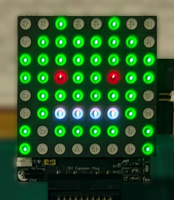

# 8x8 LED Games & Demos

 

The original 8x8 was made with some clever soldering of 64 single colour LEDs.
Not many games were made for it but those that were, were greatly appreciated.
40 years later and the 8x8 has had a colour upgrade to full RGB which makes for
much more visually pleasing and distinguishable games and demos. 

The old mono games have been modified slightly for better keyboard layout 
and to allow hexpad / matrix keyboard, or joystick input.

## King Tut's Snake
You are small snake fleeing from your enemies and fall into King Tut's tomb!
Fearing for your life, you knows you can't face those that chased you until you are much larger!

Eat the sacred scarabs to grow long enough to open the exit and seek revenge on those that wished you harm!

But beware, the walls in King Tutenkhaman's Tomb are painted with poisonous paint.

There are strange purple motifs on the ground and you can feel the Eye of Ra watching you!

Good luck!

Download [King Tuts Snake](./tutsnake.hex) and use CoolTerm to transfer it to your TEC-1G with RGB 8x8.
The game starts at $4000 and is less than 16k long. It is a good example of "multi-modal" UI with the 7 Segment displays and LCD getting used to display information.

## Upcoming Titles
- Maze by Cameron Sheppard
- TEC Invaders by Cameron Sheppard
- TEC Invaders 2 by Brian Chiha
- Maze Treasure Hunt by Brian Chiha
- Pacmo by John Hardy
- Tecmo by John Hardy
- RGB Invaders 3
- Killer Tomatoes
- Maze Runner
- Minesweeper
- Scrambler
